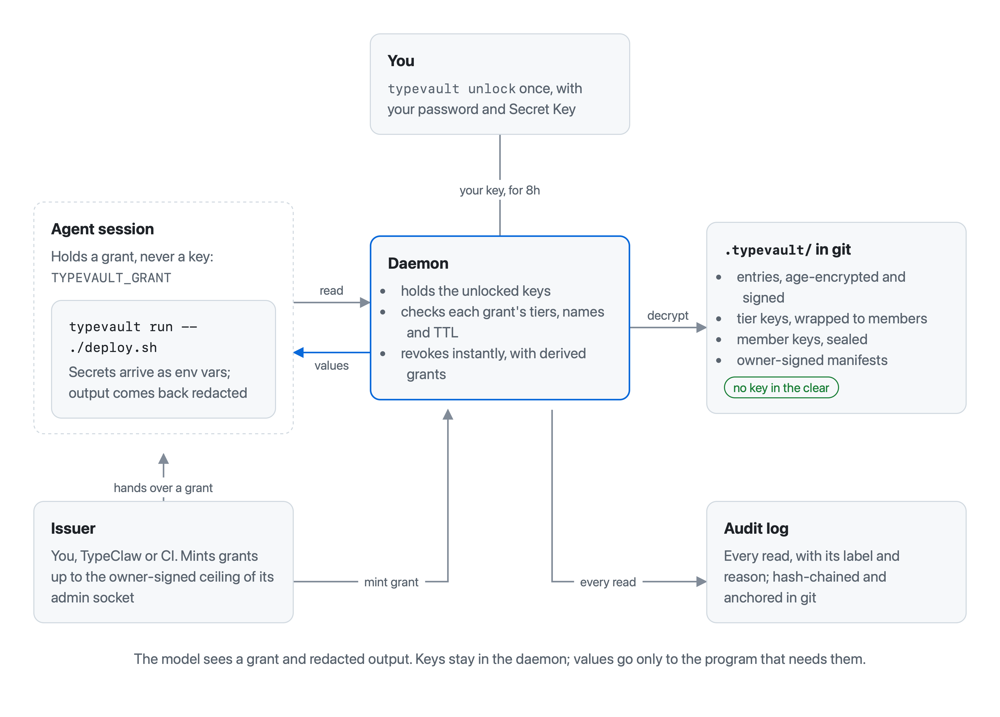
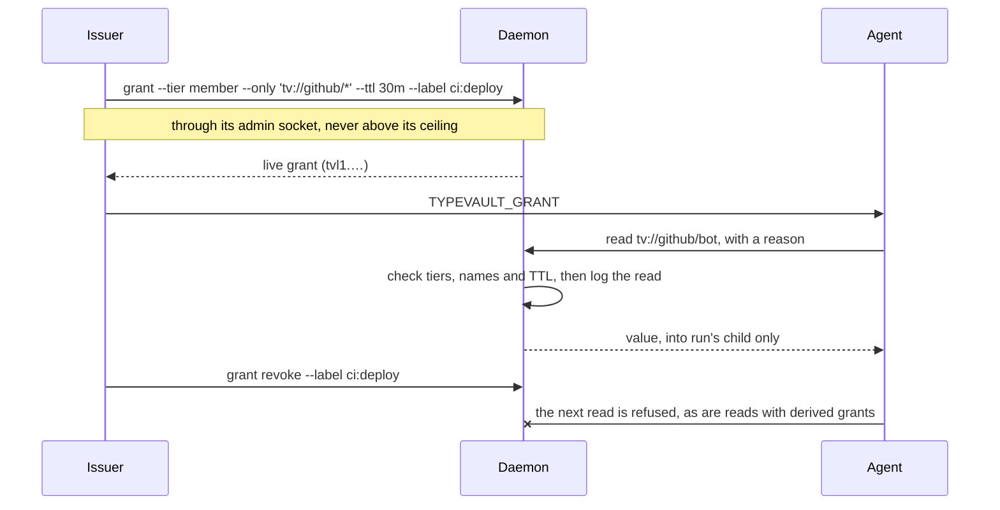
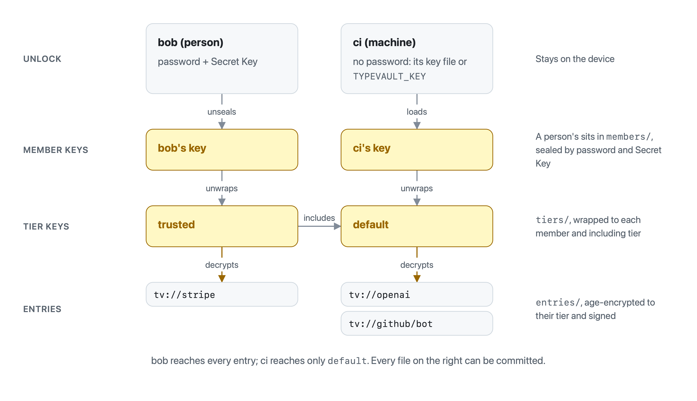
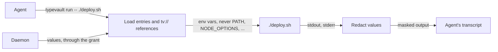
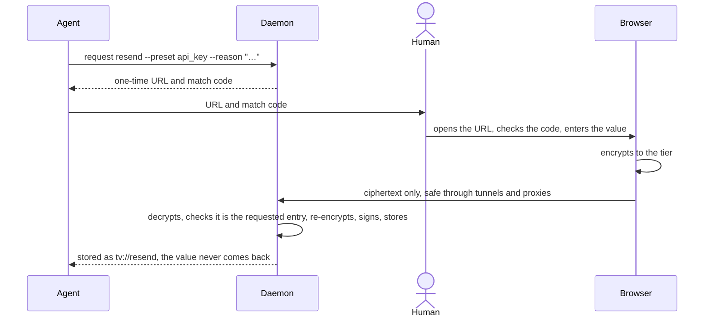

# TypeVault

**Secrets for agents, not for transcripts.** A CLI-first vault that gives each agent session only the secrets its
grant allows. Values reach programs, never the model, and every read is logged.

[](https://www.npmjs.com/package/typevault) [](#license)

<picture>
  <source media="(prefers-color-scheme: dark)" srcset="docs/diagrams/overview-dark.png">
  
</picture>

## Why TypeVault

|                        |                                                                                                    |
| ---------------------- | -------------------------------------------------------------------------------------------------- |
| **Grants, not keys**   | Agents get a short-lived grant scoped to tiers, names and a TTL. Revoking it takes effect at once. |
| **Tiers are keys**     | Each tier has its own keypair, so access comes from holding a key, not from a permission check.    |
| **Your own key**       | Every person and machine has its own key. Nobody passes a shared key or password around.           |
| **Commit it to git**   | `.typevault/` holds only ciphertext, wrapped keys and signed files. Rollbacks are refused.         |
| **Out of transcripts** | `run` passes secrets as env vars and redacts the output. The model never sees a value.             |
| **Ask a human**        | A one-time link where the browser encrypts the value before it is sent.                            |
| **Audited**            | Every read through a live grant is logged with its label and reason, in a verifiable hash chain.   |
| **Imports**            | 1Password straight from the app, plus `.env`, Bitwarden, LastPass, KeePass and CSV.                |

TypeVault is general-purpose: any agent runtime can use it. [TypeClaw](https://github.com/typeclaw/typeclaw) is its
first consumer, sandboxing each session and mounting only the agent socket.

## Install

```sh
bun add -g typevault
```

Requires Bun ≥ 1.3.

## Quickstart

```sh
typevault init                                   # creates .typevault/ here; the first time, also your password and Secret Key
typevault unlock                                 # once per session (8h by default); your agents read through it

printf '%s' "$OPENAI_KEY" | typevault set tv://openai --preset api_key --stdin
typevault set tv://anthropic --preset api_key    # from a terminal: type it in a one-time local page

export TYPEVAULT_GRANT=$(typevault grant --tier default --label session:abc)
typevault run -- ./deploy.sh                     # OPENAI and ANTHROPIC arrive as env vars; output is redacted
typevault whoami                                 # live grant, sealed grant, unlocked session or machine key
```

Commands use the nearest project vault, like `bun` and `npm`; `-g` selects the global one in `~/.typevault`.

## How it works

### Grants

An issuer (you, TypeClaw or CI) mints a grant, and the agent reads through it. The daemon checks every read against
the grant, logs it, and refuses it once the grant is revoked, along with every grant derived from it.



|                  | Live (default)                | Sealed (`--sealed`)            |
| ---------------- | ----------------------------- | ------------------------------ |
| Needs the daemon | yes                           | no                             |
| Audit            | every read                    | issue time (reads best-effort) |
| TTL / revocation | enforced / instant            | advisory / impossible          |
| Use for          | laptops, containers, typeclaw | CI, one-shot containers        |

More: [grants, ceilings and the SDK](docs/grants.md).

### Tiers and members

A secret is encrypted to its tier. Tier keys are wrapped to members, and a person's member key is sealed by their
password and a Secret Key that stays on their device. Adding or removing a member rotates every tier they reach.

<picture>
  <source media="(prefers-color-scheme: dark)" srcset="docs/diagrams/keys-dark.png">
  
</picture>

```sh
typevault tier add trusted
typevault tier include trusted default           # trusted reaches everything default reaches
typevault join                                   # a teammate, in their clone: prints the line below
typevault member add bob tvp1:... --tier default # rotates every tier bob reaches
typevault join --machine --name ci               # CI or an agent host: no password, its own key
```

More: [vaults, members and git history](docs/vaults-and-members.md).

### Running with secrets

`run` loads what the grant reaches as env vars, never sets loader variables like `PATH` or `NODE_OPTIONS`, and
redacts the child's output. A variable whose value is a `tv://` reference gets that field, so you pick the name.



```sh
DATABASE_URL=tv://postgres/prod#url typevault run -- ./migrate.sh
typevault run --only tv://github/bot -- ./login.sh
```

More: [naming, field types and what `run` loads](docs/entries.md).

### Asking a human

`typevault request` gives the agent a one-time URL and a match code to pass on. The browser encrypts the value
before sending it, so tunnels and proxies carry only ciphertext.



```sh
typevault request resend --preset api_key --reason "send the weekly digest"
```

## SDK

The same access, in-process (Bun only):

```ts
import { createClient, parseEntryName } from 'typevault'
import { createAdmin } from 'typevault/admin'
import { createRedactor } from 'typevault/redact'

// An issuer issues a grant within its socket's ceiling...
const grant = await createAdmin({ ceiling: 'bot' }).grant({ tiers: ['member'], ttl: '30m', label: 'session:abc' })

// ...and the agent side reads through it (live via the daemon, or sealed in-process).
const vault = await createClient({ grant })
const { fields } = await vault.get(parseEntryName('tv://openai'), 'send the weekly digest')

// Nothing is redacted for you: scrub anything that can reach output.
const redactor = createRedactor(await vault.readValues())
```

Options: [SDK options](docs/grants.md#sdk-options). [`skills/typevault`](./skills/typevault) teaches coding agents to
use grants, `run` and references.

## Documentation

- [Vaults and members](docs/vaults-and-members.md): project and global vaults, unlocking, joining, git history
- [Entries and `run`](docs/entries.md): naming, field types and presets, env names, references, redaction
- [Grants](docs/grants.md): live and sealed grants, ceilings, asking a human, SDK options
- [Owner tasks and imports](docs/owner-tasks.md): rotation, audit, identity backup, 1Password and file imports
- [Reference](docs/reference.md): environment variables, on-disk layout, known limits

## Development

```sh
git clone https://github.com/typeclaw/typevault
cd typevault
bun install
bun test
```

Pre-commit checks (all must pass):

```sh
bun run typecheck
bun run lint
bun run format:check
```

## Acknowledgments

- **Encryption** is [age](https://age-encryption.org), via [age-encryption](https://github.com/FiloSottile/typage) by [@FiloSottile](https://github.com/FiloSottile).
- **Signatures and hashing** come from [@noble/curves](https://github.com/paulmillr/noble-curves) and [@noble/hashes](https://github.com/paulmillr/noble-hashes) by [@paulmillr](https://github.com/paulmillr).

## License

MIT
